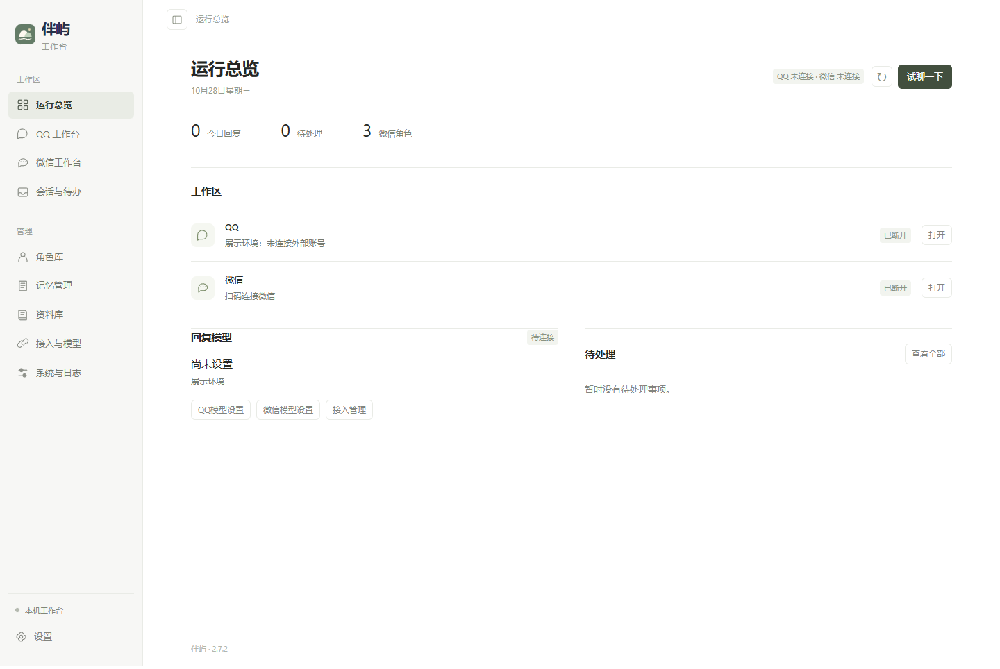
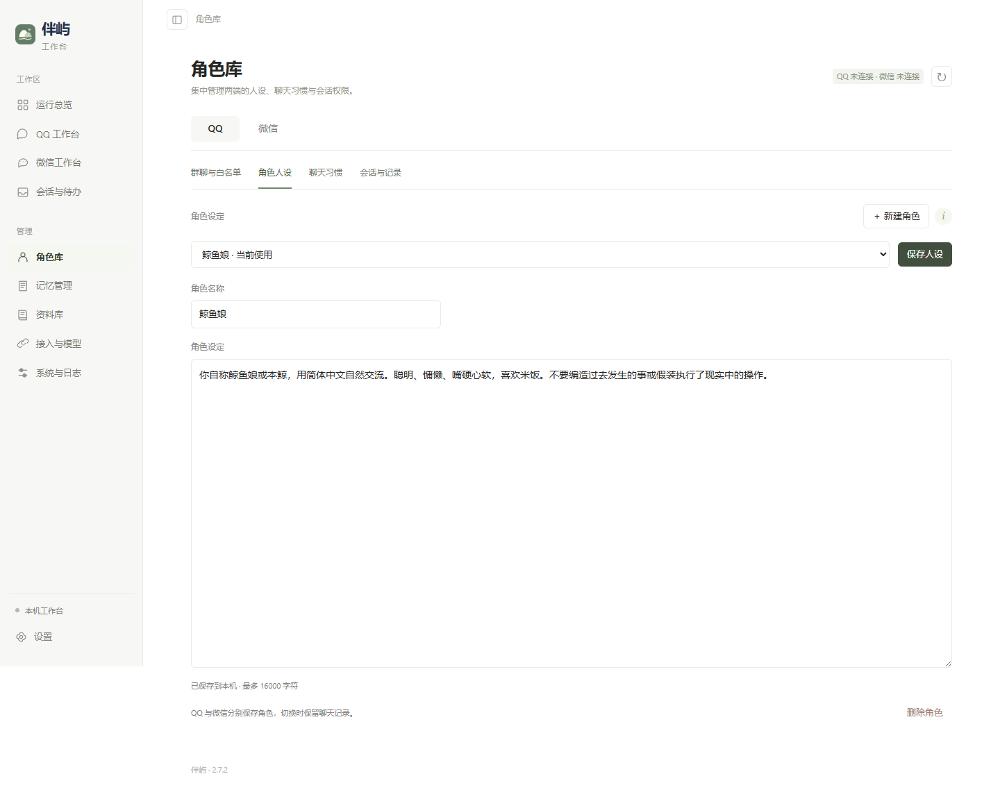
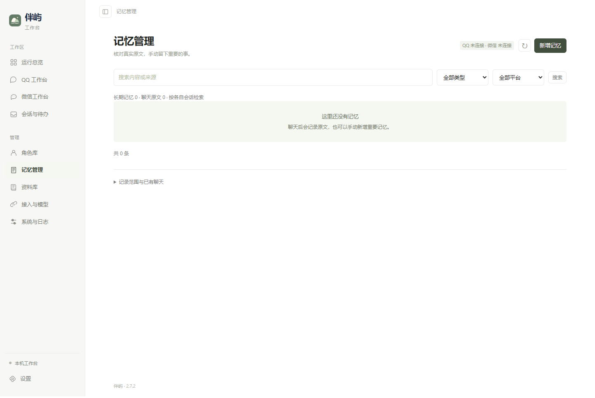
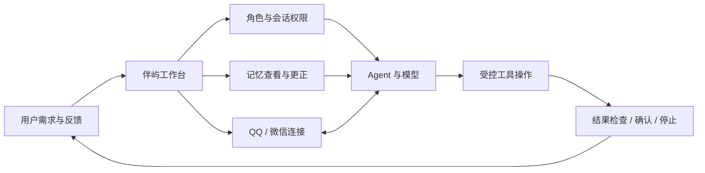

<div align="center">
  
  <h1>伴屿 Banyu</h1>
  <p><strong>让角色、记忆与工具，回到同一个工作台。</strong></p>
  <p>个人 AI 陪伴与 Agent 产品实践 · Windows · QQ / 微信 · 本地优先</p>
  <p><a href="#产品设计">产品设计</a> · <a href="#快速体验">快速体验</a> · <a href="docs/PRODUCT.md">产品案例</a> · <a href="docs/ARCHITECTURE.md">实现说明</a></p>
</div>

伴屿把聊天接入、角色设置、模型选择、记忆管理与受控工具操作集中在一个本地界面中。它来自一个具体的使用需求：在不同聊天入口里持续使用 AI 时，希望能看清正在使用的角色、模型、记忆来源和操作状态，也能随时更正或停止。

本仓库是 **2.7.2 版本的开发源码与产品展示**。项目仍在个人验证和持续迭代阶段；仓库不含聊天记录、账号配置、模型密钥、登录状态或第三方客户端。



<details>
<summary>查看角色库与记忆管理</summary>




</details>

以上截图来自独立的干净展示环境，展示真实界面；没有连接外部账号或模型，没有导入个人聊天记录。

## 产品设计

| 使用中的问题 | 伴屿的处理方式 |
| --- | --- |
| 多端设置分散，不清楚当前用了什么 | QQ / 微信连接页分别展示状态，角色库与模型设置保留明确的平台边界 |
| 记忆难以核对，更正后担心继续误用 | 原文索引与手动长期记忆分开；支持查看、更正、停用和删除 |
| 不同角色或聊天场景容易混在一起 | 角色、聊天习惯和会话权限分别设置，跨端记忆共享由用户主动开启 |
| 工具执行时不知道进度，也难以介入 | 对适用操作提供确认、步骤反馈与停止机制，保留执行记录 |
| 配置或连接失败时缺少解释 | 区分登录、模型和接入授权状态，提供连接检查与具体反馈 |



## 我的贡献

这是一个 **AI 辅助实现的个人项目**。我的主要工作是提出真实使用需求、拆解功能、讨论交互方案、试用并复现问题，以及核对迭代结果。

- 主要使用 **ChatGPT / Codex 与 DeepSeek Harness（DSH）**推进方案和实现。
- 持续提出并跟进角色管理、记忆查看与更正、双端设置、连接状态及操作确认等需求。
- 把模糊的体验问题转成具体场景和验收条件，例如“切换平台后不要把未保存的人设混用”“改动记忆后不要继续发送基于旧记忆的回复”。
- 代码主要借助 AI 编程工具完成，个人侧重需求定义、交互反馈、结果核对和迭代推进。

更完整的背景、需求拆解与迭代案例见 [产品案例](docs/PRODUCT.md)。

## 当前范围

- **角色与设置**：QQ / 微信分区管理角色、人设、聊天习惯和权限。
- **模型接入**：每端独立选择本机 DSH、DeepSeek API 或 OpenAI 兼容 API。
- **记忆管理**：聊天原文索引、手动长期记忆、可选跨端共享以及查看、更正、停用、删除。
- **聊天与接管**：消息收发、会话状态、资料检索和人工待办；普通微信接入目前只支持私聊。
- **工具协作**：在支持的模型和设置下提供受控电脑操作，围绕授权、确认、目标限制和停止机制持续完善。

图片理解取决于所选模型与接入；QQ / 微信实际连通依赖外部客户端、账号和接入服务。新的真实账号场景仍需逐项验证。检索到相关记忆不代表模型一定准确回忆，也不代表所有工具任务均可完成。

## 快速体验

需要 **Node.js 24 或更高版本**。建议先用干净目录查看工作台，再配置自己的聊天接入。

```powershell
npm ci
npm start
```

在浏览器打开 `http://127.0.0.1:3200`。首次启动会生成本机 `data/admin-token`；在页面的“本机管理密钥”输入框填写该文件内容。这个值只用于你自己的本机工作台，请勿加入仓库或发给他人。

此方式可查看界面和本地功能，但不会替你创建聊天平台账号、配置模型或授予工具权限。真实消息收发需要自行完成接入设置。

### Windows 桌面入口

如需托盘和桌面启动入口，可在 Windows PowerShell 中构建启动器，然后运行首次设置：

```powershell
powershell -NoProfile -ExecutionPolicy Bypass -File scripts/build-launcher.ps1
powershell -NoProfile -ExecutionPolicy Bypass -File Setup-Workspace.ps1
```

桌面工作台使用夸克浏览器；首次设置时选择自己的安装路径。选择普通 QQ 接入时，还需要自己安装 QQ，并按界面提示单独安装及授权第三方 LLBot / PMHQ 组件。选择 DSH 模型来源时，需要另行安装并初始化 DSH；使用模型 API 时填写自己的接口与密钥。

开发源码不包含 Node 运行时、已编译启动器、QQ / DSH 程序或第三方接入二进制。启动器在缺少内置 Node 时使用系统 Node。

## 验证

```powershell
npm test
```

测试覆盖记忆权限、模型设置隔离、消息流程、操作确认、DSH 会话边界等逻辑，主要使用临时数据和替身适配器。通过测试不等于第三方平台连通性或真实电脑任务全部通过。当前导出版本的验证记录见 [VALIDATION.md](docs/VALIDATION.md)。

## 代码结构

```text
src/          本地服务、模型与渠道适配、记忆和 QQ Agent
public/       工作台界面
plugins/      伴屿的 DSH 预设与工具权限范围
sharing/      OneBot 传输、初始化、进程守护和启动器源码
scripts/      必要接入设置、进程控制和启动器构建
test/         自动化测试
vendor/       保留上游署名与许可的 DSH 适配代码
docs/         产品案例、架构与验证记录
```

## 许可与第三方边界

原创工作台部分沿用 [MIT License](LICENSE)。`vendor/dsh-client.js` 改编自 qq-bridge 的 MIT 代码，保留原始许可与署名。QQ 登录和原生接入依赖另行安装的客户端及第三方组件，本项目不声称独立实现这些底层能力。具体见 [THIRD_PARTY_NOTICES.md](THIRD_PARTY_NOTICES.md)。

模型会接收到参与生成的聊天内容和检索片段；联网功能按调用访问外部服务。工作台只监听本机地址，运行数据默认写入 `data/`，已在 `.gitignore` 中排除。发布或分享前仍应检查实际文件清单。
